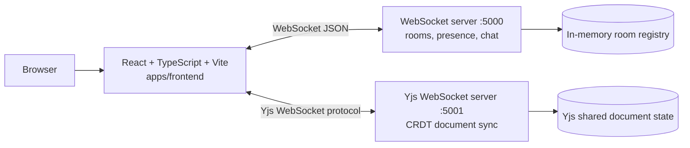
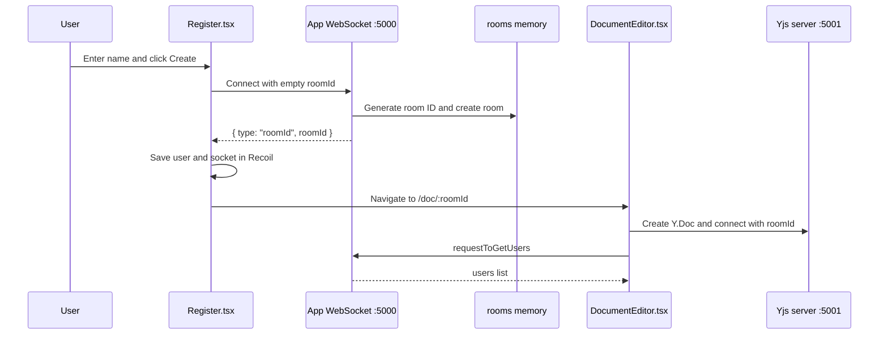
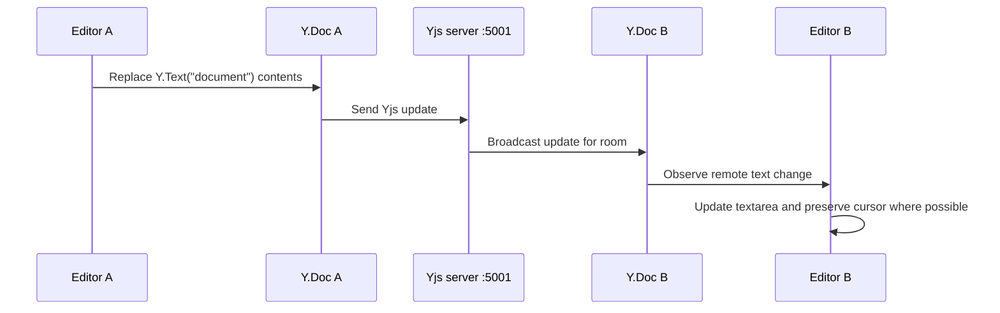

# DocSync Architecture and Technical Flow

DocSync is a real-time collaborative document editor. Users create or join a room, edit one shared document, see the other users currently online, and exchange chat messages beside the document.

## 1. High-Level Architecture



The browser uses two independent real-time connections:

1. **Application WebSocket on port 5000**: room creation, room joining, online-user presence, and chat.
2. **Yjs WebSocket on port 5001**: collaborative document text and document metadata such as the title.

Keeping these connections separate means chat/presence messages do not need to be interpreted as document operations, and Yjs can manage conflict-free document merging independently.

## 2. Repository Structure

```text
SYNC-CODE-main/
|- apps/
|  |- frontend/
|  |  |- src/main.tsx                 React entry point
|  |  |- src/App.tsx                  Browser routes
|  |  |- src/pages/Register.tsx        Create/join room and connect socket
|  |  |- src/pages/DocumentEditor.tsx  Editor, Yjs, presence, and chat UI
|  |  |- src/middleware/              Protected editor route
|  |  |- src/atoms/                   Recoil shared state
|  |  `- src/components/              UI components
|  `- websocket-server/
|     |- src/index.ts                 Two WebSocket servers and room registry
|     `- src/routers/router.ts         JSON message handlers
|- package.json                       Turborepo workspace commands
`- turbo.json                         Turborepo task configuration
```

## 3. Which Language Does What?

| Language or format          | Responsibility                                                                        |
| --------------------------- | ------------------------------------------------------------------------------------- |
| TypeScript (`.ts`)          | Backend server, WebSocket handlers, Yjs server wiring, types, and utility logic.      |
| TypeScript + JSX (`.tsx`)   | Frontend React pages, components, browser events, routing, and UI state.              |
| JavaScript runtime          | Node.js runs the compiled backend and Vite runs the frontend development server.      |
| CSS / Tailwind CSS          | Layout, colors, responsive design, and component styling.                             |
| JSON                        | `package.json` scripts/dependencies and messages sent over the application WebSocket. |
| Environment files (`.env*`) | Runtime URLs and port configuration.                                                  |
| Yjs protocol                | Binary collaborative document updates exchanged through the Yjs WebSocket provider.   |

## 4. Frontend Responsibilities

### Startup and routing

`apps/frontend/src/main.tsx` mounts React, Recoil, and the toast provider. `apps/frontend/src/App.tsx` defines these routes:

| Route          | Purpose                                                 |
| -------------- | ------------------------------------------------------- |
| `/`            | Home page.                                              |
| `/start`       | Create or join a room.                                  |
| `/:roomId`     | Create/join screen with a room code already in the URL. |
| `/doc/:roomId` | Collaborative editor.                                   |

`ProtectedRouter` checks that the Recoil user state contains both a user ID and room ID. If not, the user is redirected to the room entry page.

### Creating or joining a room

`Register.tsx` performs the following work:

1. Reads the user's name and optional room code.
2. Generates a local user ID when one does not already exist.
3. Opens `VITE_WEBSOCKET_SERVER_URL?roomId=...&id=...&name=...`.
4. Sends no initial command: the backend decides whether the connection creates or joins a room.
5. Receives a `roomId` message.
6. Stores `{ id, name, roomId }` in `userAtom` and the socket in `socketAtom`.
7. Navigates to `/doc/:roomId`.

### Document editor

`DocumentEditor.tsx` owns the room experience:

- Creates a `Y.Doc` for the current room.
- Creates a `WebsocketProvider` using `VITE_YJS_SERVER_URL` and the room ID.
- Uses the Yjs text type named `document` for the editor contents.
- Uses the Yjs map named `meta` for document metadata, currently the title.
- Displays remote text and title updates in the textarea and title control.
- Uses the port 5000 socket for presence and chat.
- Renders `UserList` and `ChatWindow` in the right sidebar.

## 5. Backend Responsibilities

### Application WebSocket server: port 5000

`apps/websocket-server/src/index.ts` creates a Node HTTP server and attaches a `ws` WebSocket server. It maintains the current rooms in:

```ts
const rooms: any = {};
```

Each room contains connected users with their user ID, name, and WebSocket instance. The registry is process-local memory.

On connection, the server:

1. Reads `roomId`, `id`, and `name` from the URL query string.
2. Generates a room ID when no room ID is supplied.
3. Sends `{ type: "roomId", roomId, ... }` to the new client.
4. Adds the user to the room.
5. Broadcasts the current user list to everyone in the room.
6. Routes later JSON messages through `requestRouter`.
7. Removes the user and broadcasts the updated list on socket close.
8. Deletes the room when its last user leaves.

### Request router

`apps/websocket-server/src/routers/router.ts` contains the application message handlers:

| Message type        | Backend behavior                                                                   |
| ------------------- | ---------------------------------------------------------------------------------- |
| `requestToGetUsers` | Builds the current room user list and broadcasts a `users` message.                |
| `requestForAllData` | Finds another room member and sends a direct `requestForAllData` message.          |
| `users`             | Relays a supplied user list to other users, excluding the sender.                  |
| `chat_message`      | Relays text, optional image URL, sender information, and timestamp to other users. |

The sender displays its own chat message immediately in `DocumentEditor.tsx`; the server broadcasts the message to the other clients.

### Yjs WebSocket server: port 5001

The second server is created in `src/index.ts` with `y-websocket`'s `setupWSConnection`. It receives Yjs provider connections and synchronizes the Yjs document associated with the room name. This server is responsible for CRDT document updates, not presence or chat messages.

## 6. End-to-End Technical Flows

### Flow A: Create a room



### Flow B: Join an existing room

1. The second user enters the room code.
2. `Register.tsx` connects to port 5000 with that code.
3. The backend finds the existing room and adds the user.
4. The backend broadcasts the new `users` list.
5. The frontend receives the room ID and opens `/doc/:roomId`.
6. `DocumentEditor.tsx` connects to Yjs using the same room ID.
7. Yjs synchronizes the existing document state to the new client.

The room ID is therefore the shared key for both application messages and the Yjs document.

### Flow C: Edit the document



Yjs represents edits as CRDT operations. Concurrent changes can be merged without a central locking step. The current editor applies the textarea value as one Yjs transaction by deleting the old text and inserting the new value.

### Flow D: Change the title

1. The user edits the title in `DocumentEditor.tsx`.
2. The local React state changes immediately.
3. The title is stored as `ydoc.getMap("meta").set("title", newTitle)`.
4. Yjs sends the map update through port 5001.
5. Other clients observe the map and update their displayed title.

### Flow E: Presence

1. The port 5000 server adds each connected user to `rooms[roomId]`.
2. The server broadcasts `{ type: "users", users: [...] }` after joins and leaves.
3. `DocumentEditor.tsx` stores the list in `connectedUsersAtom`.
4. `UserList` renders the current room members.
5. When a socket closes, the server removes the user and broadcasts again.

### Flow F: Chat

1. The user submits text or an image URL in `ChatWindow`.
2. `DocumentEditor.tsx` displays the message locally for immediate feedback.
3. It sends a JSON `chat_message` over port 5000.
4. `router.ts` adds the sender ID and broadcasts the message to other room members.
5. Other editor instances append the received message to their local message state.

## 7. Important Message Contracts

### Room connection response

```json
{
  "type": "roomId",
  "roomId": "generated-or-existing-room-id",
  "isNewRoom": true,
  "message": "Created new room"
}
```

### Presence message

```json
{
  "type": "users",
  "users": [{ "id": "12345", "name": "A user" }]
}
```

### Chat message

```json
{
  "type": "chat_message",
  "text": "Hello",
  "imageUrl": "optional-url",
  "senderId": "12345",
  "senderName": "A user",
  "timestamp": 1710000000000
}
```

The frontend sends `roomId` with chat messages, but the backend uses the room associated with the WebSocket connection as the routing authority.

## 8. Configuration and Local Run

Frontend `.env.local`:

```env
VITE_WEBSOCKET_SERVER_URL=ws://localhost:5000
VITE_YJS_SERVER_URL=ws://localhost:5001
```

Backend `.env`:

```env
PORT=5000
```

Start both applications from the repository root with separate terminals:

```bash
cd apps/websocket-server
npm run dev
```

```bash
cd apps/frontend
npm run dev
```

Then open `http://localhost:5173`. Open a second browser tab, join the same room, and test text, title, presence, and chat synchronization.

Root Turborepo commands include:

```bash
npm run dev
npm run build
npm run lint
npm run format
```

## 9. Current Operational Characteristics

- **No user authentication**: a user ID and display name are supplied by the client.
- **No durable room database**: port 5000 stores presence in memory and loses it when the server restarts.
- **No Redis integration in the current code path**: `REDIS_URL` appears in the example environment file, but `src/index.ts` currently uses the local `rooms` object and does not connect to Redis.
- **Yjs is the collaboration authority for document text and title**: application WebSocket messages do not carry editor content.
- **Two backend ports are required**: port 5000 for application events and port 5001 for Yjs synchronization.
- **The browser must reach both ports**: a working frontend alone is not enough for collaboration.

## 10. Short Summary

The frontend is a React and TypeScript client. It uses Recoil for user/socket state, a normal WebSocket for room presence and chat, and a Yjs WebSocket provider for the shared document. The backend is a Node.js and TypeScript service with two WebSocket servers: a custom port 5000 server for room events and a `y-websocket` port 5001 server for CRDT document synchronization. Both sides use the same room ID to connect users to the same collaboration space.
