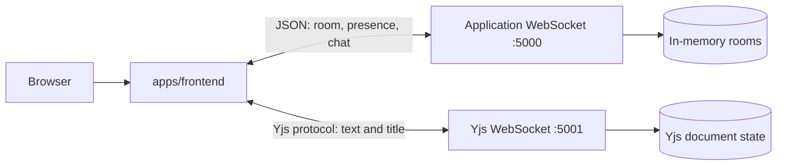

# DocSync Repository Structure

This document explains the purpose and connections of the important folders and
files in the DocSync monorepo. For every entry, use these four questions:

1. **Why does this exist?**
2. **What responsibility does it have?**
3. **Who calls or uses it?**
4. **What does it communicate with?**

Generated dependencies and build output are listed at the end because they are
part of the local workspace, but they are not application source code.

## 1. Repository Root

```text
SYNC-CODE-main/
|- apps/
|  |- frontend/
|  `- websocket-server/
|- .gitignore
|- ARCHITECTURE_AND_FLOW.md
|- package.json
|- package-lock.json
|- turbo.json
|- README.md
`- REPOSITORY_STRUCTURE.md
```

### `apps/`

- **Why does this exist?** It groups the runnable applications in the monorepo.
- **Responsibility:** It separates the browser client from the real-time backend.
- **Who uses it?** npm workspaces and Turborepo discover projects inside it.
- **Communicates with:** `frontend` communicates with `websocket-server` at runtime.

### `package.json`

- **Why does this exist?** It defines the monorepo package and shared commands.
- **Responsibility:** It configures npm workspaces, Node requirements, dependencies, and `dev`, `build`, `lint`, and `format` scripts.
- **Who uses it?** npm, Turborepo, and developers running repository commands.
- **Communicates with:** `apps/*/package.json`, `turbo.json`, and the npm registry through the lockfile.

### `package-lock.json`

- **Why does this exist?** It records the exact dependency tree installed by npm.
- **Responsibility:** It makes dependency installation repeatable.
- **Who uses it?** npm during installation and CI builds.
- **Communicates with:** Root and app `package.json` files and the npm package registry.

### `turbo.json`

- **Why does this exist?** It describes how Turborepo runs tasks across workspaces.
- **Responsibility:** It defines task relationships, caching, and outputs for commands such as build and lint.
- **Who uses it?** The root npm scripts through the `turbo` CLI.
- **Communicates with:** `apps/frontend` and `apps/websocket-server` package scripts.

### `README.md`

- **Why does this exist?** It gives the project overview and quick-start instructions.
- **Responsibility:** It explains DocSync's features, technology stack, setup, and local run commands.
- **Who uses it?** New contributors and operators starting the project.
- **Communicates with:** The frontend and backend READMEs and the environment configuration files.

### `ARCHITECTURE_AND_FLOW.md`

- **Why does this exist?** It records the high-level architecture and end-to-end runtime flows.
- **Responsibility:** It explains routes, WebSocket channels, Yjs synchronization, presence, and chat.
- **Who uses it?** Developers debugging or extending collaboration behavior.
- **Communicates with:** `apps/frontend/src` and `apps/websocket-server/src`.

### `REPOSITORY_STRUCTURE.md`

- **Why does this exist?** It provides the file-by-file ownership guide requested for this repository.
- **Responsibility:** It answers why each important folder or file exists, what it does, who uses it, and what it communicates with.
- **Who uses it?** Contributors learning the codebase or deciding where a change belongs.
- **Communicates with:** The complete source and configuration tree described below.

### `.gitignore`

- **Why does this exist?** It prevents local, generated, and secret files from being committed.
- **Responsibility:** It defines files Git should ignore, such as dependencies, build output, and environment files.
- **Who uses it?** Git and every contributor making changes.
- **Communicates with:** The working tree and repository history.

## 2. Frontend: `apps/frontend/`

```text
apps/frontend/
|- public/
|- src/
|  |- atoms/
|  |- components/
|  |  `- ui/
|  |- middleware/
|  |- pages/
|  `- utils/
|- .env / .env.example
|- index.html
|- package.json
|- README.md
|- vite.config.ts
|- tailwind.config.js
|- components.json
|- eslint.config.js
|- tsconfig*.json
`- package-lock.json
```

### `apps/frontend/`

- **Why does this exist?** It contains the user-facing DocSync application.
- **Responsibility:** It renders room entry, collaborative editing, presence, chat, routing, and styling.
- **Who uses it?** The browser, started by Vite in development or served as a production build.
- **Communicates with:** Users through the DOM, the application WebSocket on port 5000, and Yjs WebSocket on port 5001.

### `apps/frontend/package.json`

- **Why does this exist?** It defines frontend dependencies and commands.
- **Responsibility:** It configures Vite, React, TypeScript, ESLint, Tailwind, Recoil, Yjs, and UI libraries.
- **Who uses it?** npm, Vite, ESLint, and the root Turborepo tasks.
- **Communicates with:** Source imports and the frontend build toolchain.

### `apps/frontend/package-lock.json`

- **Why does this exist?** It locks the frontend dependency tree.
- **Responsibility:** It ensures consistent frontend installs.
- **Who uses it?** npm when installing from this app directory.
- **Communicates with:** `apps/frontend/package.json` and the npm registry.

### `apps/frontend/README.md`

- **Why does this exist?** It documents frontend-specific setup and key components.
- **Responsibility:** It explains environment variables, the dev command, and the main editor components.
- **Who uses it?** Frontend contributors.
- **Communicates with:** The frontend source and backend WebSocket requirements.

### `apps/frontend/.env`

- **Why does this exist?** It supplies local frontend runtime configuration.
- **Responsibility:** It stores the application WebSocket and Yjs server URLs for Vite.
- **Who uses it?** Vite through `import.meta.env`.
- **Communicates with:** `Register.tsx` and `DocumentEditor.tsx`.

### `apps/frontend/.env.example`

- **Why does this exist?** It shows which environment variables a frontend developer must configure.
- **Responsibility:** It provides safe placeholder values without local secrets.
- **Who uses it?** Contributors creating their local environment file.
- **Communicates with:** The frontend runtime configuration consumed by Vite.

### `apps/frontend/index.html`

- **Why does this exist?** It is Vite's browser HTML entry point.
- **Responsibility:** It provides the `root` element where React mounts and the document metadata.
- **Who uses it?** The browser and Vite.
- **Communicates with:** `src/main.tsx` through the `root` element.

### `apps/frontend/public/`

- **Why does this exist?** It stores static assets copied without bundling.
- **Responsibility:** It serves files such as `vite.svg` at stable public URLs.
- **Who uses it?** Vite and the browser when an asset is referenced by URL.
- **Communicates with:** `index.html` or UI code that requests public assets.

### `apps/frontend/public/vite.svg`

- **Why does this exist?** It is the default Vite static asset retained in the public directory.
- **Responsibility:** It provides a standalone SVG asset; it is not part of DocSync's collaboration logic.
- **Who uses it?** Any page that references it, currently mainly the default Vite asset setup.
- **Communicates with:** The browser's asset loader.

### `apps/frontend/src/`

- **Why does this exist?** It contains all frontend application source code.
- **Responsibility:** It defines startup, routes, state, pages, components, utilities, and styles.
- **Who uses it?** Vite bundles it into the browser application.
- **Communicates with:** The DOM, Recoil state, the two WebSocket services, and browser APIs.

### `apps/frontend/src/main.tsx`

- **Why does this exist?** It is the React application entry point.
- **Responsibility:** It mounts `App` and provides `RecoilRoot` and the toast provider.
- **Who uses it?** `index.html` and Vite.
- **Communicates with:** `App.tsx`, Recoil, Sonner, and the browser DOM.

### `apps/frontend/src/App.tsx`

- **Why does this exist?** It centralizes browser route definitions.
- **Responsibility:** It maps `/`, `/start`, `/:roomId`, and `/doc/:roomId` to the correct page or protected route.
- **Who uses it?** `main.tsx` renders it as the root component.
- **Communicates with:** React Router, `Home`, `Register`, and `ProtectedRouter`.

### `apps/frontend/src/App.css`

- **Why does this exist?** It holds application-level CSS that is separate from the global stylesheet.
- **Responsibility:** It provides shared visual rules used by the frontend where imported.
- **Who uses it?** Components importing the stylesheet.
- **Communicates with:** The browser CSS engine and frontend components.

### `apps/frontend/src/index.css`

- **Why does this exist?** It establishes global styles and Tailwind layers.
- **Responsibility:** It defines document-wide base styling, utility support, and theme rules.
- **Who uses it?** `main.tsx`, which imports it at startup.
- **Communicates with:** Tailwind, the browser CSS engine, and every rendered component.

### `apps/frontend/src/vite-env.d.ts`

- **Why does this exist?** It gives TypeScript the Vite client and `import.meta.env` declarations.
- **Responsibility:** It supplies compile-time types for Vite-specific browser features.
- **Who uses it?** TypeScript while checking frontend files.
- **Communicates with:** Vite's type definitions and source files using environment variables.

## 3. Frontend State, Pages, and Middleware

### `apps/frontend/src/atoms/`

- **Why does this exist?** It groups Recoil atoms for shared browser state.
- **Responsibility:** It stores the current user, application WebSocket, and connected users.
- **Who uses it?** Pages and components that need state shared across routes.
- **Communicates with:** Recoil's provider in `main.tsx` and the WebSocket event handlers.

### `src/atoms/userAtom.ts`

- **Why does this exist?** The editor and room pages need one shared identity and room record.
- **Responsibility:** It stores the local user's ID, display name, and room ID.
- **Who uses it?** `Register`, `ProtectedRouter`, and `DocumentEditor`.
- **Communicates with:** Recoil and the port 5000 room connection.

### `src/atoms/socketAtom.ts`

- **Why does this exist?** The room socket must survive navigation from registration to the editor.
- **Responsibility:** It stores the active application `WebSocket` instance.
- **Who uses it?** `Register` creates it; `DocumentEditor` listens and sends through it.
- **Communicates with:** The application WebSocket server on port 5000.

### `src/atoms/connectedUsersAtom.ts`

- **Why does this exist?** Presence data is received in the editor but rendered by the user list.
- **Responsibility:** It stores the current room member list.
- **Who uses it?** `DocumentEditor` updates it and `UsersList` reads it.
- **Communicates with:** Presence messages from the application WebSocket.

### `src/pages/`

- **Why does this exist?** It separates route-level screens from reusable UI components.
- **Responsibility:** It contains home, room registration, and collaborative editor screens.
- **Who uses it?** `App.tsx` through React Router.
- **Communicates with:** Recoil state, child components, browser navigation, and WebSocket services.

### `src/pages/Home.tsx`

- **Why does this exist?** It provides the landing screen and entry point into a workspace.
- **Responsibility:** It presents the product entry UI and links users to room creation or joining.
- **Who uses it?** `App.tsx` at `/`.
- **Communicates with:** React Router and reusable visual components.

### `src/pages/Register.tsx`

- **Why does this exist?** Users need a screen to create a room or join an existing one.
- **Responsibility:** It collects the name and room code, opens the port 5000 socket, stores identity, and navigates to the editor.
- **Who uses it?** `App.tsx` at `/start` and `/:roomId`.
- **Communicates with:** `userAtom`, `socketAtom`, React Router, and the application WebSocket server.

### `src/pages/DocumentEditor.tsx`

- **Why does this exist?** It is the main collaborative workspace.
- **Responsibility:** It connects Yjs document state, synchronizes title and text, handles presence and chat, and renders the editor layout.
- **Who uses it?** `ProtectedRouter` at `/doc/:roomId`.
- **Communicates with:** Yjs on port 5001, application WebSocket on port 5000, Recoil atoms, `ChatWindow`, and `UsersList`.

### `src/middleware/`

- **Why does this exist?** Route access checks belong between routing and protected page rendering.
- **Responsibility:** It prevents users without room identity from opening the editor directly.
- **Who uses it?** `App.tsx` wraps the editor route with it.
- **Communicates with:** Recoil user state and React Router navigation.

### `src/middleware/ProtectedRouter.tsx`

- **Why does this exist?** The editor requires a connected user and room.
- **Responsibility:** It checks Recoil state and redirects incomplete sessions to `/start`.
- **Who uses it?** `App.tsx` for the `/doc/:roomId` route.
- **Communicates with:** `userAtom`, React Router, and the protected editor component.

### `src/utils/`

- **Why does this exist?** It keeps reusable non-UI helpers separate from pages and components.
- **Responsibility:** It contains editor-related snippets and utility data.
- **Who uses it?** Editor UI or other frontend modules that need the shared helper.
- **Communicates with:** Monaco/editor-facing components and TypeScript imports.

### `src/utils/monacoSnippets.ts`

- **Why does this exist?** It centralizes reusable Monaco editor snippet definitions.
- **Responsibility:** It provides snippet data instead of embedding it in a page component.
- **Who uses it?** Any editor component that imports the snippets.
- **Communicates with:** TypeScript consumers and the Monaco editor API when connected.

## 4. Frontend Components and UI

### `src/components/`

- **Why does this exist?** It holds reusable UI and collaboration widgets.
- **Responsibility:** It separates chat, presence, decorative layout, and primitive controls from route screens.
- **Who uses it?** `Home`, `Register`, and `DocumentEditor`.
- **Communicates with:** Recoil/state through props, browser events, and the styling system.

### `src/components/ChatWindow.tsx`

- **Why does this exist?** Chat belongs beside the document without being embedded in editor logic.
- **Responsibility:** It renders messages and collects text or image chat input, then calls its send callback.
- **Who uses it?** `DocumentEditor`.
- **Communicates with:** `DocumentEditor` through props and the browser input/DOM events.

### `src/components/UsersList.tsx`

- **Why does this exist?** Presence needs a dedicated, reusable display.
- **Responsibility:** It renders connected users and room information.
- **Who uses it?** `DocumentEditor`.
- **Communicates with:** `connectedUsersAtom` data passed by `DocumentEditor` and the browser UI.

### `src/components/FadedGrid.tsx`

- **Why does this exist?** It provides a reusable decorative grid background.
- **Responsibility:** It renders visual background structure without owning application state.
- **Who uses it?** Pages that include the decorative grid.
- **Communicates with:** Tailwind/CSS classes and the browser renderer.

### `src/components/ui/`

- **Why does this exist?** It groups reusable design-system primitives.
- **Responsibility:** It provides consistent buttons, inputs, cards, menus, notifications, and patterns.
- **Who uses it?** Feature pages and components such as `Register`.
- **Communicates with:** Radix UI, Sonner, Tailwind utilities, and parent component props.

### `src/components/ui/button.tsx`

- **Why does this exist?** Buttons need one reusable styling and accessibility contract.
- **Responsibility:** It exposes button variants and forwards button behavior.
- **Who uses it?** `Register` and any screen needing a button.
- **Communicates with:** React, class-variance-authority, and Tailwind styles.

### `src/components/ui/input.tsx`

- **Why does this exist?** Text fields should share a consistent input implementation.
- **Responsibility:** It wraps a native input with common styles and forwarded props.
- **Who uses it?** `Register` and other forms.
- **Communicates with:** React events and Tailwind styles.

### `src/components/ui/card.tsx`

- **Why does this exist?** Repeated panel/card styling should be composable.
- **Responsibility:** It provides card, header, content, footer, and related layout primitives.
- **Who uses it?** UI screens that need framed content.
- **Communicates with:** React props and Tailwind styles.

### `src/components/ui/dropdown-menu.tsx`

- **Why does this exist?** Menus need accessible interaction behavior.
- **Responsibility:** It adapts Radix dropdown primitives into the project's styling conventions.
- **Who uses it?** Components that need menus or action lists.
- **Communicates with:** Radix UI, React events, and the browser popover behavior.

### `src/components/ui/sonner.tsx`

- **Why does this exist?** Toast notifications need a shared theme-aware wrapper.
- **Responsibility:** It configures or wraps Sonner toast presentation.
- **Who uses it?** Application startup or feature components that show notifications.
- **Communicates with:** Sonner and the global theme/CSS.

### `src/components/ui/aceternity/grid-pattern.tsx`

- **Why does this exist?** It provides the styled grid pattern used by the room-entry experience.
- **Responsibility:** It renders a reusable decorative background pattern.
- **Who uses it?** `Register`.
- **Communicates with:** React SVG/rendering and Tailwind/CSS styling.

## 5. Frontend Tooling and Configuration

### `apps/frontend/vite.config.ts`

- **Why does this exist?** Vite needs project-specific build and development configuration.
- **Responsibility:** It enables React and configures the frontend bundler/dev server.
- **Who uses it?** Vite for `dev`, `build`, and `preview`.
- **Communicates with:** React plugin, TypeScript source, and environment variables.

### `apps/frontend/tailwind.config.js`

- **Why does this exist?** Tailwind needs to know where to scan classes and how to theme them.
- **Responsibility:** It configures Tailwind content paths and project styling options.
- **Who uses it?** Tailwind/PostCSS during CSS generation.
- **Communicates with:** JSX/TSX class names and global CSS.

### `apps/frontend/components.json`

- **Why does this exist?** It configures the UI component generator/conventions.
- **Responsibility:** It records aliases and component styling conventions used by the UI layer.
- **Who uses it?** Component tooling and developers adding UI primitives.
- **Communicates with:** `src/components/ui` and TypeScript path aliases.

### `apps/frontend/eslint.config.js`

- **Why does this exist?** Frontend code needs automated quality and style checks.
- **Responsibility:** It defines ESLint rules and plugins for TypeScript, React, and hooks.
- **Who uses it?** `npm run lint` and the editor's ESLint integration.
- **Communicates with:** Frontend source files and ESLint plugins.

### `apps/frontend/tsconfig.json`, `tsconfig.app.json`, `tsconfig.node.json`

- **Why does this exist?** TypeScript needs separate settings for the app and Node-based tooling.
- **Responsibility:** They define compiler options, project references, module resolution, and included files.
- **Who uses it?** TypeScript, Vite, and the frontend build script.
- **Communicates with:** `.tsx` application code, `vite.config.ts`, and Vite type declarations.

### `apps/frontend/.gitignore`

- **Why does this exist?** Frontend builds and local settings should not be committed.
- **Responsibility:** It ignores frontend-specific generated files and local environment data.
- **Who uses it?** Git within the frontend project.
- **Communicates with:** `dist/`, `.env`, and local dependency/build state.

## 6. WebSocket Backend: `apps/websocket-server/`

### `apps/websocket-server/`

- **Why does this exist?** The browser needs a backend for room membership, presence, and chat.
- **Responsibility:** It runs the application WebSocket server on port 5000 and the Yjs server on port 5001.
- **Who uses it?** `Register.tsx` and `DocumentEditor.tsx` through WebSocket connections.
- **Communicates with:** Browser clients, the in-memory room registry, and Yjs.

### `apps/websocket-server/src/`

- **Why does this exist?** It contains the backend TypeScript source.
- **Responsibility:** It starts servers and routes application messages.
- **Who uses it?** The backend dev runner or compiled Node process.
- **Communicates with:** `ws`, `y-websocket`, environment configuration, and frontend clients.

### `apps/websocket-server/src/index.ts`

- **Why does this exist?** The backend needs one process entry point to start both real-time services.
- **Responsibility:** It creates the port 5000 WebSocket server, manages in-memory rooms, broadcasts presence, removes disconnected users, and starts the port 5001 Yjs server.
- **Who uses it?** `npm run dev` through `ts-node-dev`, or `npm start` through compiled output.
- **Communicates with:** Browser WebSockets, `requestRouter`, `ws`, `dotenv`, `hyperdyperid`, and `y-websocket`.

### `apps/websocket-server/src/routers/`

- **Why does this exist?** Message-specific behavior should be separate from connection lifecycle code.
- **Responsibility:** It groups handlers for JSON application messages.
- **Who uses it?** `src/index.ts` when a client sends a message.
- **Communicates with:** The room context supplied by `index.ts` and connected frontend clients.

### `apps/websocket-server/src/routers/router.ts`

- **Why does this exist?** The server needs a central dispatch table for client message types.
- **Responsibility:** It handles user-list requests, direct data requests, presence relays, and chat broadcasts.
- **Who uses it?** `src/index.ts` looks up a handler by `data.type`.
- **Communicates with:** In-memory rooms, broadcast helpers, direct-send helpers, and frontend JSON messages.

### `apps/websocket-server/package.json`

- **Why does this exist?** It defines backend dependencies and lifecycle commands.
- **Responsibility:** It configures TypeScript compilation, development reload, production start, and WebSocket/Yjs packages.
- **Who uses it?** npm, `ts-node-dev`, TypeScript, and the root Turborepo scripts.
- **Communicates with:** `src/index.ts`, `src/routers/router.ts`, and the Node runtime.

### `apps/websocket-server/package-lock.json`

- **Why does this exist?** It locks backend dependency versions.
- **Responsibility:** It makes backend installs reproducible.
- **Who uses it?** npm and backend deployment/CI tasks.
- **Communicates with:** The backend package manifest and npm registry.

### `apps/websocket-server/.env`

- **Why does this exist?** It supplies local backend runtime settings.
- **Responsibility:** It configures the application WebSocket port, with port 5000 as the fallback.
- **Who uses it?** `dotenv` and `src/index.ts`.
- **Communicates with:** The backend process and frontend connection URL.

### `apps/websocket-server/.env.example`

- **Why does this exist?** It documents the backend environment contract without local values.
- **Responsibility:** It gives contributors a template for the backend port setting.
- **Who uses it?** Developers setting up a local backend.
- **Communicates with:** `dotenv` and `src/index.ts`.

### `apps/websocket-server/Dockerfile`

- **Why does this exist?** It defines a container image recipe for backend deployment.
- **Responsibility:** It describes how to install dependencies, build TypeScript, and run the server in a container.
- **Who uses it?** Docker and deployment pipelines.
- **Communicates with:** `package.json`, compiled `dist/`, environment variables, and ports 5000/5001.

### `apps/websocket-server/tsconfig.json`

- **Why does this exist?** TypeScript needs backend-specific compiler settings.
- **Responsibility:** It controls module output, type checking, source inclusion, and the `dist` build.
- **Who uses it?** The backend `build` script and editor tooling.
- **Communicates with:** Backend `.ts` files and the Node.js runtime.

### `apps/websocket-server/tsconfig.tsbuildinfo`

- **Why does this exist?** TypeScript can cache incremental build information.
- **Responsibility:** It speeds up repeated type checks/builds.
- **Who uses it?** TypeScript when incremental compilation is enabled.
- **Communicates with:** `tsconfig.json` and the backend source tree.

### `apps/websocket-server/README.md`

- **Why does this exist?** It documents the backend's two-server model and development command.
- **Responsibility:** It explains ports 5000 and 5001 and the local in-memory design.
- **Who uses it?** Backend contributors and operators.
- **Communicates with:** `src/index.ts`, `.env.example`, and frontend setup instructions.

### `apps/websocket-server/.gitignore`

- **Why does this exist?** Backend build output and local settings should remain untracked.
- **Responsibility:** It excludes backend-specific generated and environment files.
- **Who uses it?** Git within the backend project.
- **Communicates with:** `dist/`, `.env`, and TypeScript build state.

## 7. Generated and Local-Only Directories

These directories are intentionally not treated as application ownership surfaces.
They are created by tooling or local installation and normally should not be
edited by hand.

### `node_modules/` and `node_modules_broken/`

- **Why do these exist?** They contain installed JavaScript dependencies; `node_modules_broken` is a local alternate or damaged dependency tree.
- **Responsibility:** They provide packages imported by the root, frontend, and backend projects.
- **Who uses them?** Node.js, npm scripts, Vite, TypeScript, and the application runtime.
- **Communicate with:** The package manifests and lockfiles; application source imports them.

### `apps/frontend/dist/` and `apps/websocket-server/dist/`

- **Why do these exist?** They contain build output for deployment or preview.
- **Responsibility:** Frontend `dist` contains bundled browser assets; backend `dist` contains compiled Node JavaScript.
- **Who uses them?** Vite preview, static hosting, Docker, or `npm start`.
- **Communicate with:** Build tools, the browser, and the Node runtime.

### `.turbo/` and `apps/*/.turbo/`

- **Why do these exist?** Turborepo stores local task/cache metadata there.
- **Responsibility:** They speed up repeated workspace tasks.
- **Who uses them?** The Turborepo CLI.
- **Communicate with:** `turbo.json`, package scripts, and build outputs.

## 8. Runtime Communication Summary



- The frontend uses port **5000** for room creation, joining, presence, and chat.
- The frontend uses port **5001** for collaborative document text and title synchronization.
- The backend's room registry is process-local memory, so room membership is lost when the server restarts.
- `node_modules`, `dist`, `.turbo`, and lockfiles support development or deployment but do not own product behavior.
